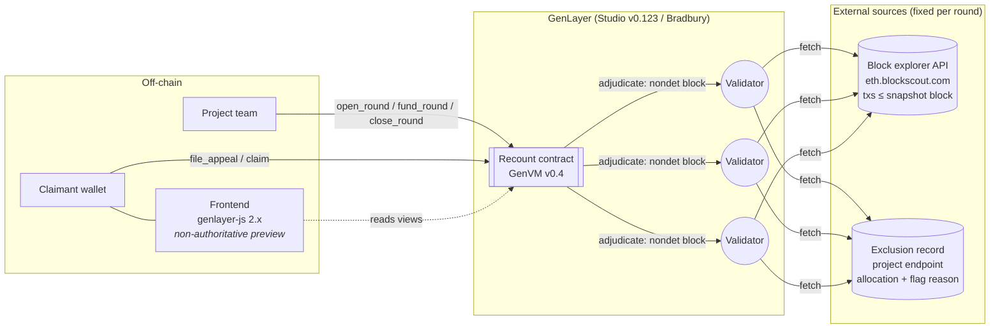
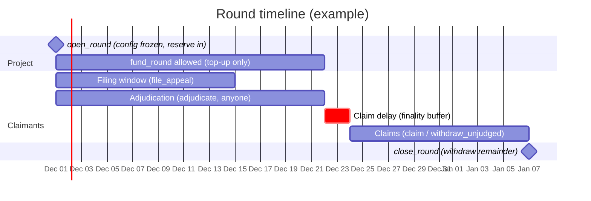
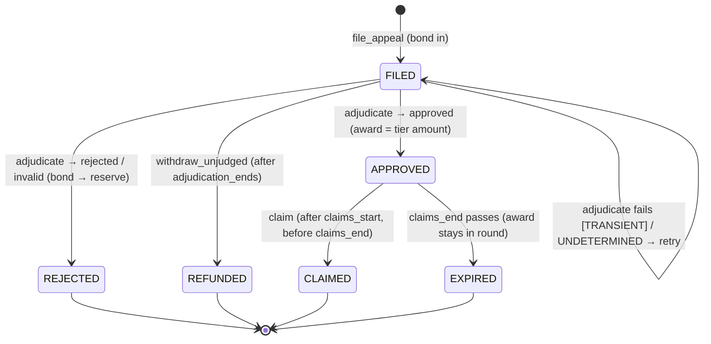
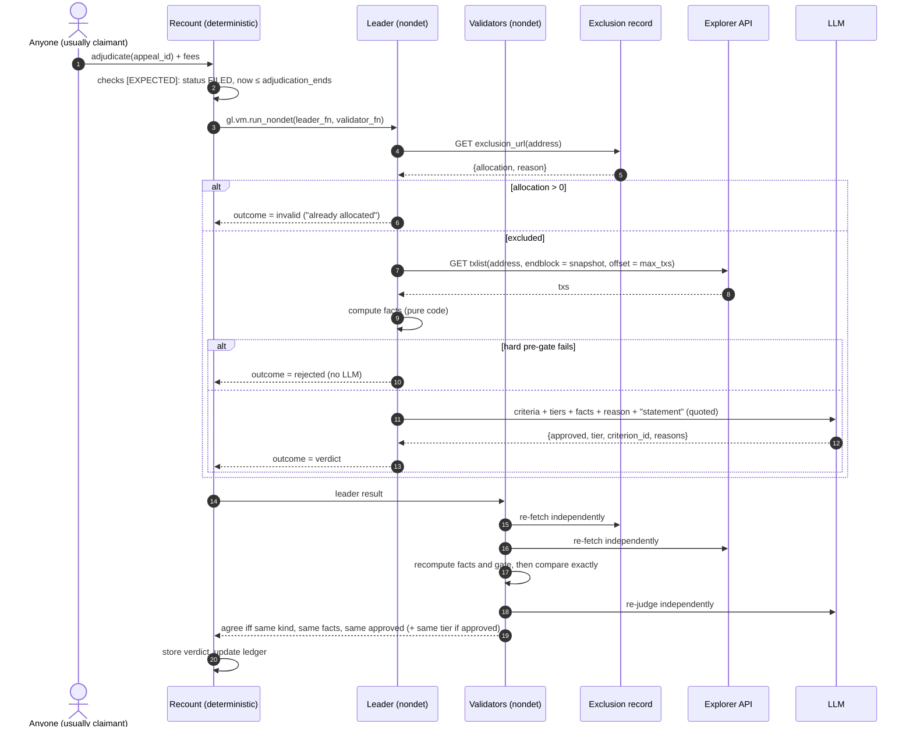
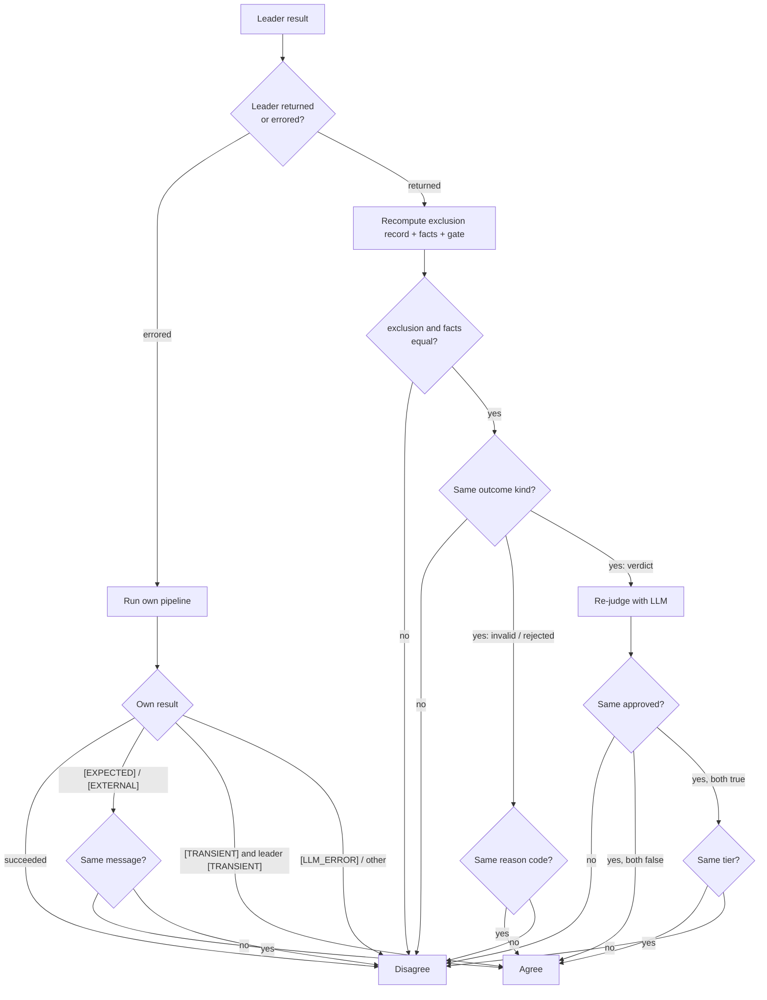
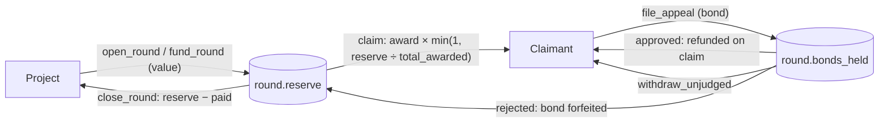
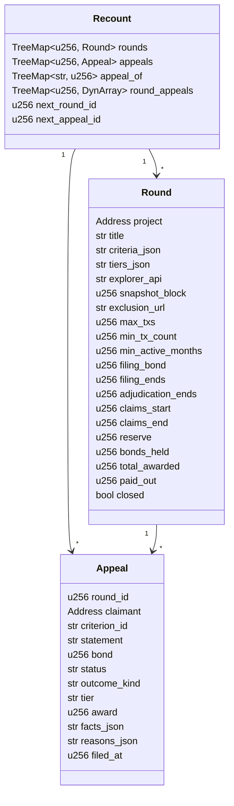

# Recount: architecture

The engineering design for v1. The reasoning behind each choice is in [REVIEW.md](REVIEW.md). Diagrams are Mermaid, so they render on GitHub.

---

## 1. System context



## 2. Round lifecycle (time)



The timestamps are enforced in contract code with the transaction time from `gl.message.raw["datetime"]`. Do not use `gl.vm.get_timestamp()`: the Studio v0.123 host rejects it (`SystemError: 2: inval`). Clients must schedule rounds from the contract's `get_time()` view, never from their own clock: on 2026-11-25 Studio was about 30 minutes ahead of a local clock.

```
created ≤ filing_ends ≤ adjudication_ends
claims_start = adjudication_ends + claim_delay     (claim_delay ≥ MIN_CLAIM_DELAY)
claims_start < claims_end
```

## 3. Appeal state machine



## 4. Adjudication sequence (the consensus path)



## 5. Validator decision (equivalence rule)



## 6. Money flow (per round ledger)



Invariants, checked in direct tests:

- `paid_out ≤ reserve` at all times.
- After `adjudication_ends`, `reserve` and `total_awarded` never change. Claims depend only on those two numbers, so payouts are order-independent.
- `payout(a) = award(a)` if `reserve ≥ total_awarded`, otherwise `award(a) × reserve // total_awarded`.
- Contract-wide: the sum over all rounds of `reserve + bonds_held − paid_out − withdrawn` equals the contract's balance (ignoring fees, which are not paid from the balance).

## 7. Storage layout

All storage fields are class-level annotations. Dataclasses use `@gl.storage.allow`, and new fields are only ever appended at the end.



Key formats: `appeal_of` keys are `"<round_id>:<address lowercase>"`; `criteria_json` is `[{id, text}]`; `tiers_json` is `[{id, amount, description}]` (amount in atto); `Appeal.status` ∈ `FILED APPROVED REJECTED REFUNDED CLAIMED`; `outcome_kind` ∈ `invalid rejected verdict`.

## 8. Public interface

| Method | Kind | Who | Effect |
|---|---|---|---|
| `open_round(config_json)` | `write.payable` | project | Validate and freeze the config; reserve = value sent |
| `fund_round(round_id)` | `write.payable` | anyone | Top up the reserve before `adjudication_ends` |
| `file_appeal(round_id, criterion_id, statement)` | `write.payable` | claimant | Value must equal `filing_bond`; one appeal per address per round |
| `adjudicate(appeal_id)` | `write` | anyone | Consensus verdict (§4) |
| `claim(appeal_id)` | `write` | claimant | Pro-rata award plus bond refund via `emit_transfer` |
| `withdraw_unjudged(appeal_id)` | `write` | claimant | Bond refund for an appeal that was never judged |
| `close_round(round_id)` | `write` | project | After `claims_end`: transfer the remainder to the project |
| `get_time()` | `view` | — | Chain time (unix seconds); use it to schedule rounds |
| `get_round(round_id)` | `view` | — | Config, ledger and phase |
| `get_appeal(appeal_id)` | `view` | — | Status, verdict, facts, reasons |
| `get_appeal_of(round_id, address)` | `view` | — | The appeal id for an address, or none |
| `list_appeals(round_id, offset, limit)` | `view` | — | Paged list of appeal ids |
| `preview_payout(appeal_id)` | `view` | — | What `claim` would pay right now |

## 9. Facts schema (exact-compared)

Computed from at most `max_txs` transactions with `blockNumber ≤ snapshot_block`. The explorer request is `module=account&action=txlist&startblock=0&endblock=<snapshot>&page=1&offset=<max_txs>&sort=asc`.

```json
{
  "tx_count": 42,
  "truncated": false,
  "outgoing_count": 30,
  "incoming_count": 12,
  "failed_count": 1,
  "first_tx_date": "2024-03-02",
  "last_tx_date": "2025-11-30",
  "active_months": 14,
  "active_days": 37,
  "distinct_counterparties": 19,
  "first_funder": "0xabc…",
  "contract_creations": 0
}
```

The facts are serialized with `json.dumps(sort_keys=True)` before comparison. Addresses are lowercase, and dates are UTC `YYYY-MM-DD`.

## 10. Error taxonomy

| Prefix | Raised when | Validator rule |
|---|---|---|
| `[EXPECTED]` | Bad phase or caller, wrong bond, duplicate appeal, unknown round or appeal, invalid config | Exact message match |
| `[EXTERNAL]` | Source returned 400/404/410, or malformed JSON from a source | Exact message match |
| `[TRANSIENT]` | 401/403/408/429/5xx, redirects, explorer `NOTOK` | Agree only if both are transient; the transaction fails and the appeal stays `FILED`, so it can be retried |
| `[LLM_ERROR]` | Non-dict output, missing `approved`, unknown tier | Always disagree, which forces rotation |

## 11. Fees

Every call carries fees (Consensus v0.6). Estimate them first:

- JS: `client.estimateTransactionFees(...)`
- Python: `client.estimate_transaction_fees(...)`
- CLI: `genlayer estimate-fees <addr> <method> --args … --json`

Then pass the result as `fees: {distribution, feeValue}` (or `--fees`). `claim`, `withdraw_unjudged` and `close_round` emit an external value message, so their estimates need a message-fee budget. The integration test suite will produce `fee-profile.json` with `gltest --fee-profile`, covering every transfer branch.

A transaction counts as successful only when its status is `ACCEPTED`/`FINALIZED` **and** its execution result is `FINISHED_WITH_RETURN`. Tests assert this with `tx_execution_succeeded`.

## 12. Repository layout

```
Recount/
├── README.md
├── docs/
│   ├── REVIEW.md
│   └── ARCHITECTURE.md
├── contracts/
│   └── recount.py                # single file, v0.4 header
├── fixtures/                     # mock explorer + exclusion JSON for tests and demo
├── tests/
│   ├── direct/                   # genlayer-test 0.30 direct mode
│   └── integration/              # gltest on studionet (needs fees)
├── gltest.config.yaml
├── requirements.txt
└── .gitignore
```
